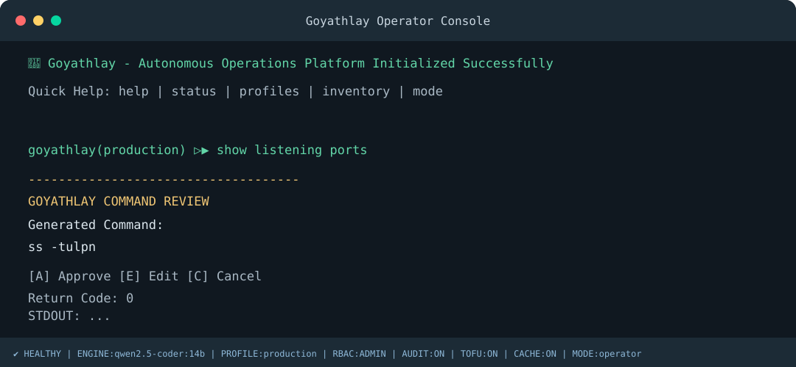

# Goyathlay

Goyathlay is a local-first shell and infrastructure assistant under active development. Natural-language command generation uses a local Ollama server; generated shell commands require explicit review before execution. Database and SSH operations add their own validation, trust, approval, and audit boundaries.

The repository also retains the original `akasha.py` application and installer. Goyathlay development does not remove that legacy functionality.

## Requirements

- Python 3.12 or later
- A locally installed Ollama server and a pulled local model for natural-language shell prompts
- Optional: PostgreSQL `psycopg` or SQL Server `pyodbc` driver for those database integrations
- Optional: an ODBC SQL Server driver for the host operating system

No public LLM provider is used. Ollama itself must be available locally. SSH, database, and Meraki API operations naturally require access to their target services when used.

## Install and run

```sh
python3 scripts/install_goyathlay.py
# or: ./scripts/install_goyathlay.sh
source .venv-goyathlay/bin/activate
python3 -m goyathlay.goyathlay
```

The installer requires Python 3.12+, repairs or creates `.venv-goyathlay`, installs the dependencies in the root `requirements.txt`, checks Ollama, and pulls `qwen2.5-coder:7b` if missing. It validates a local command-generation smoke test and does not execute the generated command. A rebuilt environment is staged and only replaces the current venv after validation succeeds. Optional drivers can be installed separately, for example `python3 -m pip install 'psycopg[binary]'` or `python3 -m pip install pyodbc`.

The provider defaults to `qwen2.5-coder:14b`. The installer uses `qwen2.5-coder:7b` for its required smoke test. Set `GOYATHLAY_OLLAMA_MODEL=qwen2.5-coder:7b` (or another locally pulled model) when launching to select the 7B model. Before generating a command, the CLI checks that the Python package, local Ollama daemon, and configured model are available.

Successful installer output ends with:

```text
====================================
GOYATHLAY INSTALLATION COMPLETE
====================================
Python: OK
Virtual Environment: OK
Dependencies: OK
Ollama: OK
Model: OK
Runtime: OK
```

On macOS, the system commonly provides `python3` but no `python` command. A freshly created and activated virtual environment includes its own `python` command. You can also use `python3` explicitly after activation. To run without activating the environment, use `python3 -m venv .venv-goyathlay` once, install the requirements with `.venv-goyathlay/bin/python -m pip install -r goyathlay/requirements.txt`, then launch with `.venv-goyathlay/bin/python -m goyathlay.goyathlay`.

Virtual environments are specific to their Python installation and operating system; do not copy one between machines. The installer detects and repairs a stale or broken `.venv-goyathlay`. Alternatively, `./run_goyathlay.sh` selects `python` when available and otherwise uses `python3`.

## Example



```text
🚀 Goyathlay - Autonomous Operations Platform Initialized Successfully
ENGINE:qwen2.5-coder:7b | PROFILE:production | RBAC:ADMIN | AUDIT:ON | TOFU:ON

Quick Help: help | status | profiles | inventory

goyathlay(production) ▷▶ show listening ports
----------------------------------------------------
EXECUTION PLAN
----------------------------------------------------
Intent:
show listening ports

Command:
ss -tulpn

Profile:
production

Role:
ADMIN

Risk:
LOW

Reputation:
Unknown

Policy:
ALLOW
----------------------------------------------------
[A] Approve
[E] Edit
[C] Cancel
Selection: A
Return Code: 0
```

On an interactive terminal, the prompt_toolkit footer displays live profile,
role, cache, audit, TOFU, CPU, and memory status. CPU and memory show `n/a`
when the optional `psutil` package is unavailable. Ctrl+B toggles cache lookup,
Ctrl+K enables cache-only operation (no Ollama calls), Ctrl+R hides or shows
risk detail while enforcement remains active, Ctrl+P cycles policy profiles,
Ctrl+T toggles audit detail mode, Ctrl+I shows the inventory summary, and
Ctrl+H displays help. The footer shortcuts require `prompt_toolkit` installed
from `goyathlay/requirements.txt`; non-interactive stdin uses ordinary input.

Useful operator commands include `status`, `help`, `inventory`, `hosts`,
`groups`, `audit`, and `history`, in addition to the existing profile, blocklist,
maintenance, database, and remote-target commands. Database operations use the
same plain-text plan framing with engine, profile, SQL, risk, and validation
status. A network plan renderer is available for future network interpreter
integration; this UX update does not add network interpreter commands.

The `status` command reports version, engine, profile, role, audit, TOFU,
cache, inventory host and group totals, and the discovered unittest case count.
Engine setup failures use a short warning with a specific reason and repair
command instead of a traceback.

The `dryrun>` prefix previews a generated command and local policy result without approving or executing it:

```text
goyathlay> dryrun> show listening ports
DRY RUN — no command was approved or executed.
```

Useful local commands include `profiles`, `profile NAME`, `host-profile HOST PROFILE`, `blocklist`, `maintenance`, `db profiles`, `sqlite profiles`, and `mssql profiles`. Remote execution uses inventory targets such as `remote> server01 show listening ports` or an inventory group.

### Healing and repair review

`heal dry-run`, `heal auto --dry-run`, or
`python3 -m goyathlay.goyathlay --heal-auto --dry-run` performs local diagnostics
and prints a proposed repair plan. Dry-run does not create `~/.goyathlay`, save
the plan, append audit records, change permissions, or run repair commands. This
read-only guarantee takes precedence over automatic report persistence; to save
a plan explicitly, run `heal save-plan`. `heal review` asks for approval for
each repair, and `heal auto` applies only LOW/MEDIUM repairs automatically;
HIGH-risk actions always require a separate approval. Non-dry-run modes save
`~/.goyathlay/healing-plan.json` and append decisions to
`~/.goyathlay/healing-audit.jsonl`.

## Safety and scope

- Local shell execution uses argument arrays and does not use `shell=True`.
- Risk, reputation, blocklist, maintenance, RBAC, policy profiles, and explicit approval apply to shell execution.
- SSH enrolls unknown host fingerprints through explicit TOFU decisions. Parallel fan-out enrolls hosts sequentially before concurrent command execution.
- SQLite queries use read-only connections and validation. PostgreSQL and SQL Server should use database accounts restricted to read-only access. SQL validation is a lexical guard, not a SQL parser or sandbox.
- Meraki support currently describes fixed GET operations only; it does not issue HTTP requests.
- Authentication primitives and rollback plan generation exist, but account login/bootstrap and rollback execution are not integrated into the main CLI.
- This is an alpha/development project, not a production-certified security boundary. Review generated operations and grant least privilege to service accounts.

## Development checks

```sh
python3 -m unittest discover -s goyathlay/tests -v
git diff --check
```

See [docs/architecture.md](goyathlay/docs/architecture.md), [docs/security.md](goyathlay/docs/security.md), [docs/database.md](goyathlay/docs/database.md), [docs/network.md](goyathlay/docs/network.md), and [docs/roadmap.md](goyathlay/docs/roadmap.md).
