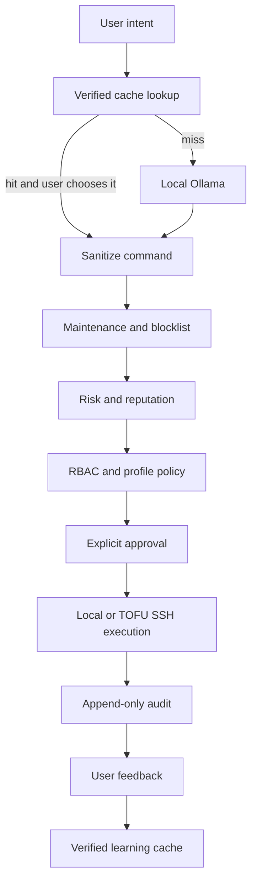

# Goyathlay architecture

Goyathlay is a Python CLI with local Ollama command generation and deterministic local decision modules. `GOYATHLAY_OLLAMA_MODEL` selects a locally installed model; the default is `qwen2.5-coder:14b`. Vendor/database interpreters and SSH/DB connectors are separate from command generation.

Database query flow is interpreter → validation → explicit approval → engine-specific executor → audit → feedback. SQLite uses Python's standard library; PostgreSQL and MSSQL drivers are optional. Network vendor interpreters currently translate only and do not connect.

## Trust boundaries

- Ollama output is untrusted input. Cleaning only normalizes output; it does not make commands safe.
- Risk scoring, reputation, SQL lexical validation, and blocklists are defense-in-depth, not sandboxes.
- Approval applies to the final edited command, with policy rechecks on shell commands.
- SSH host trust decisions occur before execution. Inventory host overrides select policy profiles. Fan-out preserves sequential enrollment, concurrent execution, stable result ordering, and per-host audit records.
- Authentication and rollback packages are foundations only: the CLI still uses its existing local admin context, and rollback plans are not executed.
